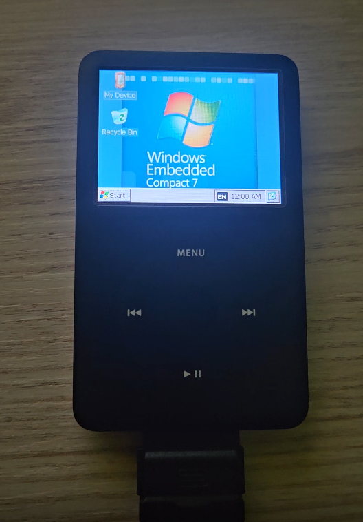

# Windows Embedded Compact 7 on the iPod classic

A Board Support Package (BSP) for running Windows Embedded Compact 7 (CE 7) on the iPod classic
(Samsung S5L8702, ARM926EJ-S, 64 MB RAM), loaded from the hard disk into memory by a modified
[Rockbox](https://www.rockbox.org/) bootloader.

[Updated Demo Video (YouTube)](https://youtu.be/_ghpg-20lIw)

## Layout

- `ipod6g/`: the BSP. Goes to `C:\WINCE700\platform\ipod6g`.
- `iPodCE/`: sample OS design (headless).
- `docs/bringup.md`: boot chain, serial wiring, how to build and test.

## Requirements

- Windows Embedded Compact 7 Platform Builder with **ARMv5** support installed.
- An iPod classic with the patched Rockbox bootloader installed and a FAT32 ("Windows formatted") disk.
- A 3.3 V USB serial adapter and a 30-pin dock breakout.

See [docs/bringup.md](docs/bringup.md).

## Hardware Support

### Current

These are hardware features that are functional

| Feature | Driver State | Comments |
|-|-|-|
| UART | Basic | Dock connector serial (UART0), 115200 8N1, no flow control. Used for KITL debugger connection with Visual Studio |
| Display | Basic | 320x240 RGB565 only. Screen updates are pushed to the LCD by the CPU, no DMA or acceleration whatsoever |
| Audio output | Basic | I2S + DMA into the codec at 44.1 kHz, through Windows' wave API with codec volume control. The driver sets up I2S and the codec itself, so it works whether Windows CE is started from Rockbox or from the bootloader (PLAY) |
| ATA HDD | Read/write | PATA (not CE-ATA) hard disks and flash adapters (iFlash). UDMA with interrupt: 6.7 MB/s (HDD) to 9 MB/s (iFlash) reads, 11 MB/s writes (iFlash) through the file system. The FAT32 volume is mounted as \iPod. Writing is on in this image (registry `AllowWrite` 1, 0 = read only); the disk's write cache is flushed 2 s after the last write and before a restart. After 10 s unused (`IdleTimeout`) the disk is switched off at the PMU (`IdlePowerOff` 1, 0 = spin down only); the next access powers it back up (about 2.5 s on the iFlash) |
| Battery | Basic | Level and charging through the PMU, taskbar icon |
| Real-time clock | Basic | Time read from the PMU at start-up |
| Clickwheel | Basic | Wheel and buttons as keys. Needs the wheel controller running as Rockbox leaves it |

### Future

**No promises that this project will be continued, but ideally I'd like to get the following implemented:**

| Feature | Comments |
|-|-|
| USB Host | Attach USB input devices to control the OS (port the DWC2 host driver from CEonPi) |
| TV Out | Output a higher resolution desktop via the TV encoder (preferably component for progressive video) |
| USB Function | Let the iPod be connected as a USB device to a computer (for Mass Storage) |

## Notes

### Bootloader

Update: A custom bootloader isn't needed, the `wince.ipod` binary can be launched from within Rockbox's own file explorer.

By default, the Rockbox bootloader can only load boot images up to 8 MB in size. A basic CE kernel image will just about fit, but if you want any sort of graphics the kernel image will exceed the maximum size and the original bootloader won't load it anymore.

A patch for the Rockbox bootloader which adds support for loading a Windows CE image `wince.ipod` of up to 32 MB from the root of the FAT32 drive when holding down the `Play/Pause` key at the bootloader is available in the [rockbox](rockbox) folder.

### Shell

Building an image with the entire CE shell is quite wasteful in terms of memory, as the Explorer based shell requires the whole network stack, which on the iPod is pointless.

Without the shell, the image is ~8 MB with everything required to run graphical apps (GWES). With the shell, the image grows to ~23 MB and takes much longer to boot, especially when connected to a debugger via KITL.

Currently, the sample VS project [iPodCE](iPodCE) has the shell catalog items selected, but I will remove them later for a lighter image.

## Credits

- The BSP structure comes from [CEonPi](https://github.com/RaduTek/CEonPi), the Windows CE 7 Raspberry Pi BSP.
- Hardware knowledge comes from the Rockbox project's iPod classic port.
